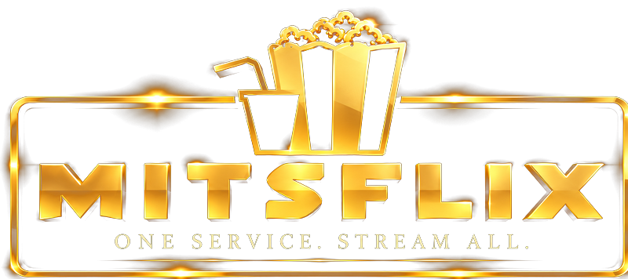

<h1 align="center">Mitsflix Player for Windows</h1>

Live TV, movies and series from any IPTV playlist — on your Windows PC or laptop.

  
  

---

## 📥 Install

1. Download **[MitsflixPlayer-Setup.exe](https://github.com/Mitsflix/MitsflixPlayer-Windows/releases/latest/download/MitsflixPlayer-Setup.exe)**
2. Open it. If Windows shows **"Windows protected your PC"**, click **More info → Run anyway**
3. Add your playlist and start watching

Works on Windows 10 and 11 (64-bit). The app updates itself when a new version is out.

On a TV box or Fire Stick? Use the Android version: Downloader code **6284643**.

## ✨ Features

- **Live TV** with categories, channel logos, search and what's on now and next
- **Movies** with posters, ratings, plots, cast and trailers
- **Series** with seasons and episodes, and resume where you left off
- **Continue watching**, **favourites** and **recent channels** on Home
- **Search** across channels, movies and series
- Any playlist: **Xtream Codes** login or **M3U** link, and more than one playlist
- Full-screen player with keyboard shortcuts, subtitles and audio tracks where the stream has them
- Gold Mitsflix look, automatic updates

**Keyboard:** Space play/pause · ← → skip 10s · ↑ ↓ volume (change channel on Live TV) · F full screen · M mute · N next episode · Esc close

## 🍿 Get a playlist

New to Mitsflix? Get your playlist at **[mitsflix.com](https://mitsflix.com)**.

---

Mitsflix Player is a player only: it doesn't include any channels, playlists or subscriptions.

Releasing an update (maintainers)

Raise `version` in `package.json` and push to `main`. GitHub Actions builds the installer and publishes it as a release; installed copies update themselves.

